# Multi Tool

One home for every tool and website I have built. Every link below is live and free to use - open it in any browser (phone or PC), no sign-up needed unless noted.

**Live hub page:** [https://akash991833.github.io/multi-tool/](https://akash991833.github.io/multi-tool/)

---

## Web tools

### 1. PDF Editor & Everyday Tools
**Open:** https://akash991833.github.io/pdf-editor/

48 small tools in one place: compress a photo to a target size (e.g. 100 KB), convert images (JPG/PNG/WebP), image to PDF and PDF to image, merge/split PDF, edit text inside a PDF, add text/images, draw, resize photos, text tools, file hash, batch rename, ZIP tools, color converter and more.

- Every tool shows original size, new size and % saved.
- Files never leave your device - everything runs in the browser.
- On Android: open the link in Chrome, pick a tool, choose files, download the result.

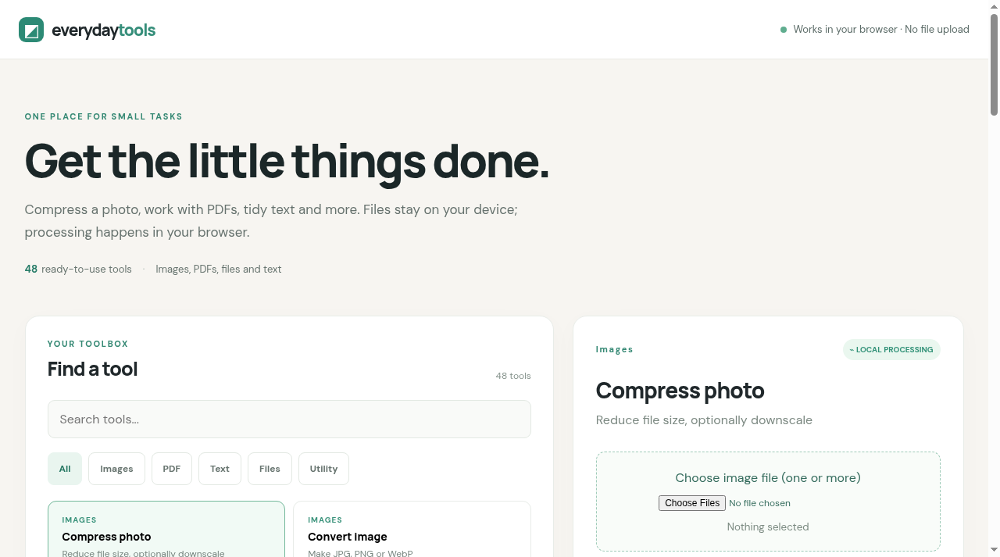

### 2. Documents & Projects Creator
**Open:** https://project-sutra-three.vercel.app

Turn your notes and content into a submission-ready assignment, project report or black book. Pick a template, paste your content, preview, export as PDF or Word. Free, no sign-in.

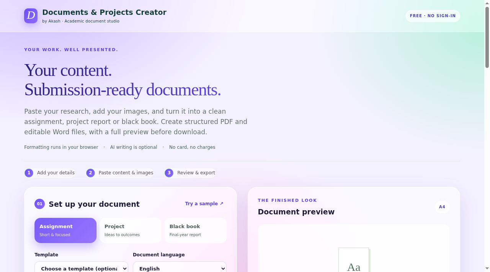

### 3. LinuxLab Terminal
**Open:** https://akash991833.github.io/linuxlab-terminal/

A real Linux kernel running in your browser. 133 guided tasks: users, files, logs, networking, services, SSH, LVM, rpm, cron and more. Good for Linux interview and job prep - no PC or install needed, works on a phone browser too.

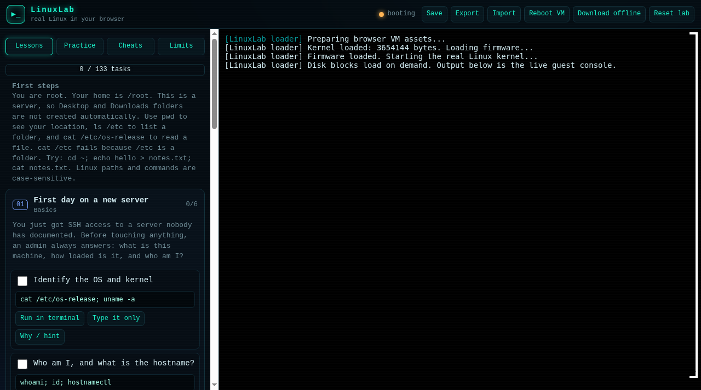

### 4. InstaPocket
**Open:** https://instagram-media-tool.vercel.app/

Paste a public Instagram link (post, reel or carousel), save the photos/videos, and share them to WhatsApp straight from the phone.

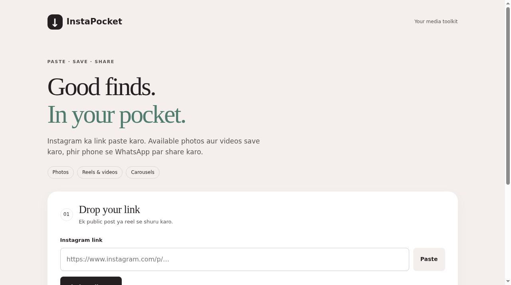

### 5. Frame Jigsaw
**Open:** https://akash991833.github.io/photo-puzzle-studio/

Upload any photo and it turns into a jigsaw puzzle you solve. Timer, move counter, works offline, photos stay on your device.

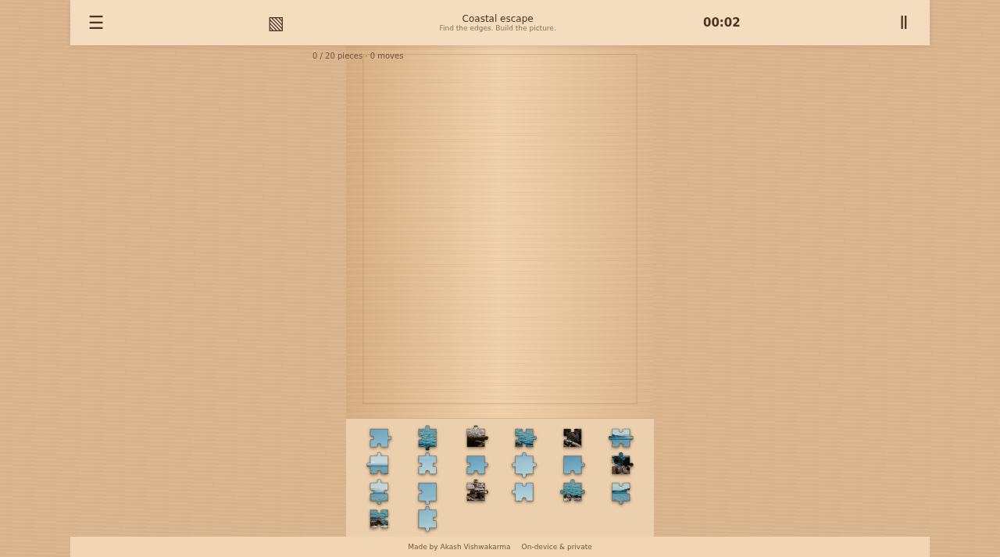

### 6. CommandDeck
**Open:** https://akash991833.github.io/commanddeck/

Linux command reference: 292 commands with 505 verified examples, flags and safety notes. Search, save favorites, Hinglish tips available.

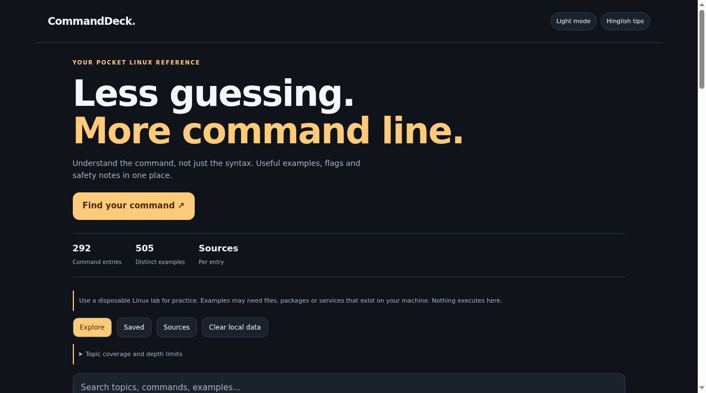

### 7. LinuxReady
**Open:** https://akash991833.github.io/linuxready/

Linux interview prep: 391 Q&A and scenario answers plus 332 quiz questions. Built for a first Linux sysadmin role.

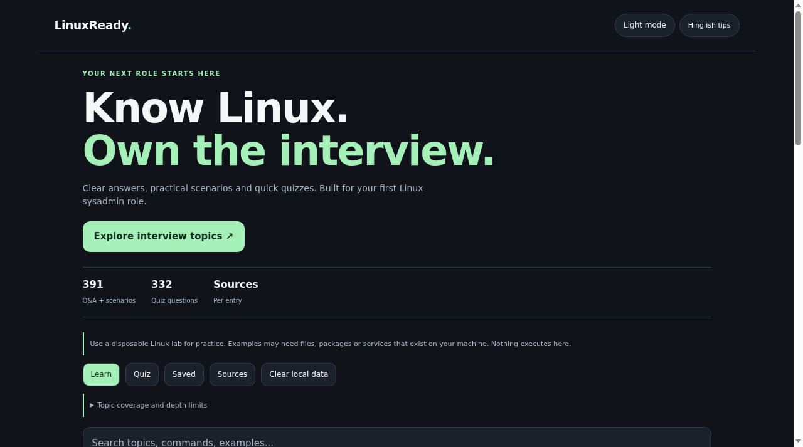

### 8. FreeShelf
**Open:** https://akash991833.github.io/freeshelf/

A directory of genuinely free resources for students and developers: courses, hosting, certificates, AI tools, resume builders, dev utilities. EN/Hinglish, dark mode.

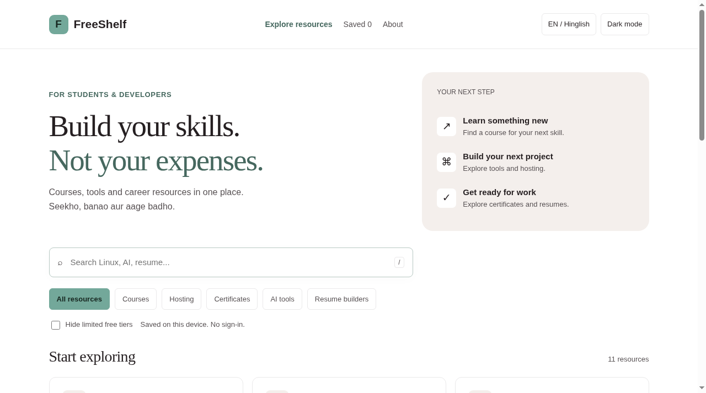

### 9. P Tracker
**Open:** https://akash991833.github.io/period-tracker-app/

Private period and health tracker for girls. Cycle predictions, tips, PIN lock. All data stays on the device - nothing is uploaded.

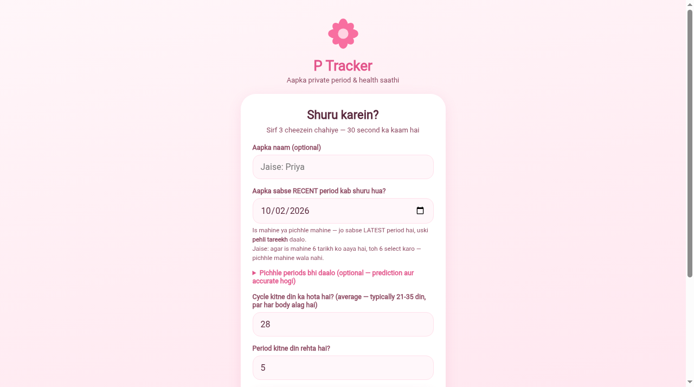

### 10. Billing Studio
**Open:** https://akash991833.github.io/test-billing-soft/

A full billing workspace that runs in the browser: invoices, customers, AMC plans, daily work logs, inventory, team, settlements and reports, with Excel/CSV export. Data stays in the browser on that device - use the built-in backup to move devices.

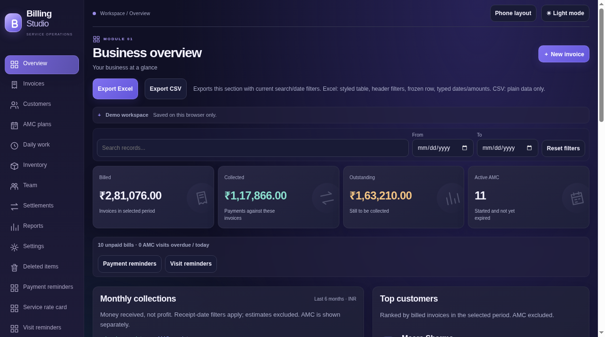

### 11. KaamLedger
**Open:** https://akash991833.github.io/kaam-ledger-worker-manager-app/

Worker hisaab made simple: attendance, daily wages, advances and payments. Phone-first, works offline, data stays on the device.

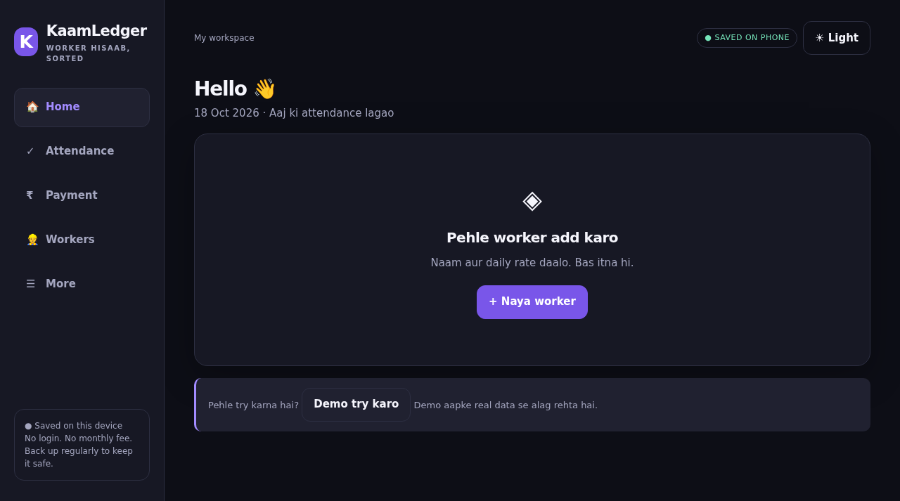

---

## Android apps

These live in their own repos - see each repo's README for the download (APK) and setup guide.

| App | What it does | Repo |
|---|---|---|
| Linux App | Learn Linux on the phone: commands, lessons, quizzes | [AKASH991833/linux-app](https://github.com/AKASH991833/linux-app) |
| DJ Booking Manager | Booking manager for a DJ business: events, clients, payments | [AKASH991833/dj-booking-manager-app](https://github.com/AKASH991833/dj-booking-manager-app) |
| Lecture Recorder | Offline screen + audio recorder for lectures (Android 10+) | [AKASH991833/lecture-recorder-app](https://github.com/AKASH991833/lecture-recorder-app) |
| Duplicate File Remover | Finds exact duplicate files on the phone | [AKASH991833/android-duplicate-file-remover](https://github.com/AKASH991833/android-duplicate-file-remover) |

---

## Websites

| Site | Link |
|---|---|
| My portfolio (terminal style) | https://akash991833.github.io |
| Ansh Air Cool - AC service business site | https://anshaircool.netlify.app |

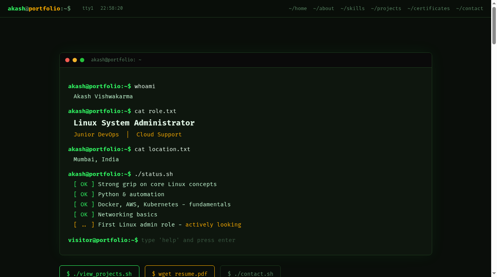

---

## How to use these on Android

1. Open Chrome and tap any **Open** link above.
2. For tools that work with files (PDF Editor, Frame Jigsaw, InstaPocket), tap the file picker and choose from your gallery/files.
3. To keep a tool on your home screen: Chrome menu (⋮) > **Add to Home screen**.

Everything here is free. Tools that say "data stays on device" do their work locally in your browser - your files are not uploaded anywhere.
